# Architektura systému Suplování Viewer

Tento dokument popisuje architekturu aplikace **Suplování Viewer**, tok dat od exportu z desktopového programu Bakaláři až po mobilní zobrazení (PWA) a klíčová bezpečnostní a provozní rozhodnutí.

---

## 1. Diagram toku dat (`složka → parser → DB → web`)

```mermaid
flowchart LR
    subgraph Bakalari["Desktop Bakaláři (Suplování)"]
        B1["Tisk sestavy (FastReport 5.0)"]
    end

    subgraph Share["Sdílená složka (SMB/CIFS, Read-Only)"]
        S1["suplprehtrid.html (UTF-8 / cp1250)"]
    end

    subgraph App["Suplování Viewer (Python 3.12 / FastAPI)"]
        W["FolderWatcher (watchdog + 30s polling + 2s stabilita)"]
        P["HTML Parser (charset-normalizer + BeautifulSoup4/lxml)"]
        DB[("SQLite DB (WAL, transakce, retence 14 dní)")]
        A["Anonymizér (zkratky / iniciály)"]
        API["FastAPI (/api/schedule, /api/events SSE, /admin/status)"]
    end

    subgraph Clients["Klienti (Intranet / Mobil / Statický web)"]
        PWA["Mobilní a desktopový prohlížeč (PWA + Service Worker)"]
        DIST["Statický export (dist/ HTML+JSON bez jmen)"]
    end

    B1 -->|"Uložení HTML"| S1
    S1 -->|"Read-only čtení"| W
    W -->|"Surové bajty po dopsání"| P
    P -->|"Atomický zápis / záznam chyby"| DB
    DB -->|"Čtení dnů a stavu"| API
    DB -->|"CLI export-static"| A
    A -->|"Volitelná anonymizace"| API
    A -->|"Generování statických souborů"| DIST
    API -->|"JSON + SSE notifikace"| PWA
```

---

## 2. Popis jednotlivých vrstev

### 2.1 Sledování složky (`app/watcher.py`)
- Kombinuje **událostní sledování** (`watchdog`) s **pravidelným záložním pollingem** (výchozí interval `30 s`), protože síťové připojené disky SMB/CIFS na Linuxu či Windows ne vždy doručují inotify/FSEvents události.
- **Ochrana proti nedopsanému souboru:** Funkce `wait_for_file_stability()` čeká, dokud velikost a čas poslední změny (`st_mtime_ns`) souboru nezůstanou beze změny po dobu `stability_seconds` (výchozí `2.0 s`).
- **Jednosměrný přístup (Read-Only):** Aplikace do sledované složky nikdy nezapisuje; v Dockeru je svazek připojen s příznakem `:ro`.
- **Ochrana proti Path Traversal:** Funkce `is_safe_child_path()` ověřuje přes `Path.resolve().is_relative_to()`, že cílový soubor neleží mimo povolenou složku.

### 2.2 Detekce kódování a HTML Parser (`app/parser.py`)
- **Detekce kódování (`detect_and_decode`):** Kontroluje BOM (`utf-8-sig`, `utf-16`), následně zkouší striktní `utf-8` se skórováním českých znaků a klíčových slov (`Suplování`, `týden`, `Nepřítomní`) a v případě neshody využívá `cp1250` (`windows-1250`), `iso-8859-2` a `charset-normalizer`. Odolá i souborům v `cp1250`, které mají v `<meta>` chybně deklarováno `charset=utf-8`.
- **Rozdělení na dny:** Jeden týdenní soubor rozdělí podle nadpisů `Suplování: <Den> d. m. rrrr` na samostatné objekty `ScheduleDay`.
- **Párování přesunů a odvození učitelů:**
  - Automaticky spáruje dvojice `přesun >>` (`na X. hod`) a `přesun <<` (`z Y. hod`).
  - Křížovou kontrolou mřížky *Nepřítomní učitelé* a tabulky *Změny v rozvrzích tříd* automaticky odvodí slovník zkratek učitelů (`Ko` ↔ `Kodad Miloš`, `Vl` ↔ `Valtr Pavel` atd.) a sestaví odvozený pohled podle učitelů.
- **Záchyt nerozpoznaných dat (F2):** Jakákoliv buňka v mřížce mimo `""`, `"-"`, `".."` a zkratku učitele nebo řádek s neznámou strukturou se uloží do `UnrecognizedItem` a zobrazí se v UI i na `/admin/status`.

### 2.3 Databázové úložiště (`app/database.py`)
- Používá vestavěnou databázi **SQLite** v režimu `WAL` (Write-Ahead Logging) pro rychlé souběžné čtení i zápis s minimálními nároky na RAM a CPU.
- **Ochrana posledních platných dat (F6):** Zápis nového exportu probíhá v jedné transakci. Pokud parser vyhodí `ParseError` (např. při změně formátu Bakalářů nebo poškozeném souboru), tabulky `schedule_days` a `class_changes` zůstanou nedotčeny, do `import_runs` se zapíše stav `ERROR` a web zobrazí varování *„Nelze zpracovat nový export“* nad posledními platnými daty.
- **Retence historie (F5):** Při každém úspěšném importu se automaticky vymažou dny starší než `retention_days` (výchozí `14 dní`).

### 2.4 Webový server, PWA a zabezpečení (`app/web.py`, `app/static/`)
- **Frontend:** Čistý Vanilla JS (`app.js`) a responzivní CSS (`styles.css`) bez externích CDN a bez nutnosti Node.js build řetězce.
- **Přístupnost (WCAG AA):** Každý typ změny je rozlišen jak barvou s vysokým kontrastem, tak ikonou a textovým štítkem (`🔄 Suplování`, `❌ Odpadá`, `🔗 Spojeno`, `🚪 Změna učebny`, `➡️ Přesun`, `➕ Navíc`, `📅 Akce třídy`).
- **Automatické obnovení:** Prohlížeč udržuje otevřené spojení Server-Sent Events (`/api/events`) a při novém exportu okamžitě načte čerstvá data bez zásahu uživatele (doplněno o 25s záložní polling).
- **PWA a Offline režim:** Obsahuje `manifest.json`, lokální ikony (`icon-192.png`, `icon-512.png`, `icon.svg`) a Service Worker (`sw.js`), který ukládá aplikační kostru i poslední odpovědi API do cache zařízení (doplněno o `localStorage`).
- **Bezpečnostní hlavičky:** Každá HTTP odpověď obsahuje striktní `Content-Security-Policy` (`default-src 'self'; script-src 'self'`), `X-Content-Type-Options: nosniff`, `X-Frame-Options: SAMEORIGIN` a `Referrer-Policy: no-referrer`. Všechna data v UI jsou vkládána přes `textContent` a na `/admin/status` přes `html.escape()`.
