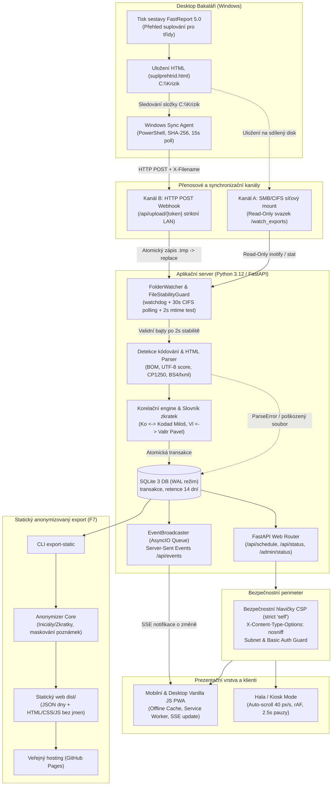

# Architektura systému – Školní zobrazení suplování (Suplování Viewer)

Tento dokument představuje autoritativní technologickou a systémovou architekturu aplikace **Suplování Viewer** pro VOŠ a SPŠE Františka Křižíka, vypracovanou v souladu s enterprise standardy spolehlivosti, bezpečnosti a nezávislosti na externím cloudu.

---

## 1. Manažerské shrnutí a architektonické principy

Systém **Suplování Viewer** slouží k automatizovanému zobrazování aktuálního suplování a změn v rozvrhu žákům, učitelům a vedení školy. Zdrojem dat je tiskový export desktopového programu Bakaláři (*Přehled suplování pro třídy* – `suplprehtrid.html`).

Klíčové architektonické principy:
1. **Read-Only Ingestion:** Systém nikdy nezapisuje do Bakalářů, nepřistupuje k jejich interní databázi ani proprietárním API. Zpracovává výhradně exportované HTML sestavy.
2. **Offline-First & Intranet Sovereignty:** Aplikace běží kompletně v lokální síti školy (Docker / Podman na Linuxu). V runtime nepoužívá žádné externí CDN, cloudové služby ani telemetrii.
3. **Princip F6 (Ochrana integrity dat):** Při nahrání poškozeného, neúplného nebo neznámého souboru systém nikdy neselže chybou 500 – zachová poslední platný stav rozvrhu, zobrazí varování uživatelům a chybu zaznamená do auditu.
4. **GDPR a soukromí (F7):** Plná jména a poznámky jsou dostupné pouze v intranetu školy. Pro veřejné zobrazení (např. GitHub Pages) slouží striktní anonymizační pipeline nahrazující jména oficiálními zkratkami.

---

## 2. Diagram systémové architektury a datových toků

---

## 3. Technologický stack a komponenty

| Vrstva | Použitá technologie | Zdůvodnění a enterprise přínos |
|---|---|---|
| **Runtime & Jazyk** | Python 3.12 | Moderní typování, vysoký výkon asynchronního I/O, stabilita. |
| **Aplikační server** | FastAPI + Uvicorn | Nízká spotřeba paměti (< 60 MB), nativní OpenAPI, asynchronní streaming. |
| **Validace dat** | Pydantic v2 | Rychlá serializace v Rust jádru (`pydantic-core`), striktní datové modely. |
| **Datové úložiště** | SQLite 3 (WAL mode) | Nulová správa, transakční bezpečnost, paralelní čtení bez zamykání. |
| **Detekce kódování** | Charset-Normalizer + CP1250 heuristika | Robustní dekódování windows-1250, utf-8 i poškozených znakových sad. |
| **HTML Parser** | BeautifulSoup4 + lxml | Rychlé parsování rozsáhlých HTML tabulek FastReportu 5.0. |
| **Filesystem Watcher** | Watchdog + Polling fallback | Okamžitá reakce na události `inotify` i spolehlivost na SMB/CIFS. |
| **Klientský frontend** | Vanilla HTML5 / ES2022 / CSS3 | Žádný npm/build overhead, bleskové načtení (< 45 KB), dlouhodobá udržovatelnost. |
| **Offline podpora** | Service Worker + Web Manifest | Splňuje standard PWA (instalace na mobil), funguje i při výpadku sítě. |
| **Kontejnerizace** | Docker / Podman (rootless OCI) | Izolace, bezpečnost, podpora AlmaLinuxu s SELinuxem (`:z` flag). |

---

## 4. Bezpečnostní architektura (Security Perimeter)

1. **Content-Security-Policy (CSP):**
   - Striktní nastavení `default-src 'self'`. Žádné načítání stylů či fontů z Google Fonts, CDNs apod.
   - Ochrana proti XSS útokům; klientský kód striktně používá `textContent` místo nebezpečného `innerHTML`.
2. **Ochrana rozhraní /admin/status:**
   - Omezení přístupu na povolené školní podsítě (`SUPL_ADMIN_ALLOWED_CIDRS`) a volitelně HTTP Basic Auth s timing-attack-safe porovnáváním hesel (`secrets.compare_digest`).
3. **Zabezpečení webhooku `/api/upload/{token}`:**
   - Dlouhý tajný klíč v URL chráněný proti časové korelaci.
   - Povolení výhradně souboru s názvem `suplprehtrid.html`.
   - Striktní limit velikosti těla požadavku (výchozí 5 MB).
4. **Anonymizační firewall:**
   - Při exportu na GitHub Pages (`export-static`) prochází data deterministickým anonymizérem.
   - Automatický test `test_static_export_contains_zero_personal_names` v testovacím balíku garantuje, že v adresáři `dist/` se nenachází žádné celé jméno učitele ze vzorků.

---

## 5. Porovnání transportních kanálů: SMB Mount vs. HTTP Webhook

V reálném školním provozu se osvědčily dva způsoby doručování exportů:
- **Kanál A (SMB/CIFS Mount):** Desktop Bakaláři ukládá export na síťový disk `S:\SuplovaniExport`. Linuxový server má tento disk připojen a monitoruje jej. Výhodou je nulová instalace na Windows; nevýhodou může být zpoždění `inotify` na CIFS nebo zamykání souborů.
- **Kanál B (HTTP POST Webhook Agent):** Na stanici zástupkyně běží lehký PowerShell agent (`windows_sync_agent.ps1` instalovaný přes `instalace_windows.bat`). Agent monitoruje složku `C:\Krizik`, testuje dokončení zápisu a odesílá soubor přímo přes HTTP na server. Tento kanál je nezávislý na portu 445 (SMB) a funguje i přes interní firewally a různé VLAN.

---

## 6. Doporučení pro další evoluci (Enterprise Roadmap)

1. **Abstrakce Ingestion vrstvy (Strategy Pattern):** Oddělení parsovací logiky do rozhraní `ScheduleParserStrategy`, které umožní v budoucnu přidat přímý import z Bakaláři REST API nebo iCal bez zásahu do webového rozhraní.
2. **Prometheus / OpenTelemetry metriky:** Zavedení endpointu `/metrics` pro sledování latence importu a počtu aktivních připojených informačních panelů.
