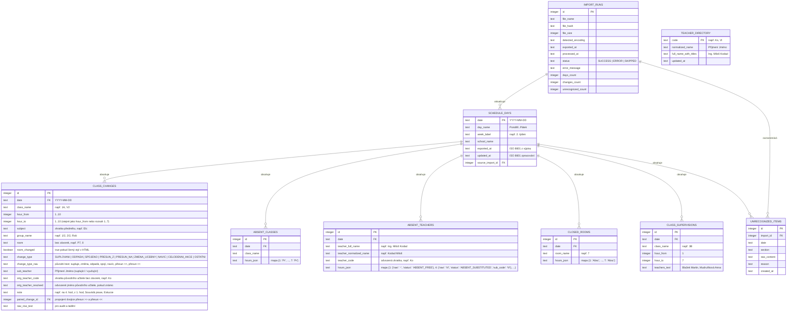

# Analýza formátu HTML exportu Bakaláři – Suplování a návrh datového modelu

Tento dokument popisuje přesnou strukturu reálného HTML exportu z desktopového modulu **Bakaláři – Suplování** (generovaného komponentou **FastReport 5.0**) na základě analýzy vzorku `samples/suplprehtrid.html` (Přehled suplování pro třídy, týden 2.–6. 11. 2026, datum výpisu 5. 11. 2026 08:26) a definuje návrh datového modelu pro uložení v SQLite a přenos do webového rozhraní (JSON API).

---

## 1. Obecná struktura HTML dokumentu a kódování

### 1.1 Hlavička a generátor
- Dokument začíná deklarací `<!DOCTYPE HTML PUBLIC "-//W3C//DTD HTML 4.01 Transitional//EN">`.
- Generátor: `<meta name="Generator" content="FastReport 5.0 http://www.fast-report.com">`.
- Titulek dokumentu: `<title>Přehled suplování pro žáky</title>`.
- Styly jsou vloženy inline v `` a definují třídy `.page_break` a `.s0` až `.s38` (písmo `Calibri`, velikosti `12px`–`21px`, barvy `#000000` a `#808080`, pozadí `#E0E0E0` pro záhlaví sekcí a okraje buněk simulující mřížku).

### 1.2 Kódování znaků (Encoding)
- Analyzovaný soubor `samples/suplprehtrid.html` má v hlavičce `<meta http-equiv="Content-Type" content="text/html; charset=utf-8">` a jeho bajtová reprezentace je validní UTF-8 (obsahuje české znaky `Ú, á, é, í, ý, Č, č, ě, ň, ř, Š, š, ť, ů, ž`, např. *Františka Křižíka*, *Šťastný Ondřej*, *Očenášková Marie*).
- V praxi však starší konfigurace Windows / Bakalářů nebo přenosy přes SMB mohou exportovat soubory v kódování **`windows-1250` (`cp1250`)** (často i s chybně uvedenou `<meta charset="utf-8">` nebo bez ní), případně s UTF-8 BOM (`utf-8-sig`) či `iso-8859-2`.
- **Strategie detekce kódování v parseru:**
  1. Kontrola BOM (`utf-8-sig`, `utf-16`).
  2. Pokus o striktní dekódování `utf-8` s validací přítomnosti typických českých znaků a klíčových slov (`Suplování`, `týden`, `Nepřítomní`, `Změny`).
  3. Detekce pomocí `charset-normalizer` / `chardet` s prioritou středoevropských kódování (`cp1250`, `iso-8859-2`) a kontrolou skóre českých diakritických znaků (zabránění záměně s `cp1252` / `latin1`, kde by se např. `ř`, `č`, `ě`, `š`, `ž` v *Křižík* či *Čermáková* poškodily).

---

## 2. Rozdělení souboru na dny a stránky

Jeden HTML soubor obsahuje **více dnů** (v `samples/suplprehtrid.html` celý týden Pondělí 2. 11. 2026 až Pátek 6. 11. 2026).

### 2.1 Stránkování a tabulky
- Každá stránka sestavy je uvozena kotvou `` (`PageN2`, …, `PageN5`) a následována elementem `<table width="718" border="0" cellspacing="0" cellpadding="0">` (od druhé tabulky dále s atributem `class="page_break"`).
- Každá tabulka používá **21 virtuálních sloupců** definovaných v prvním řádku `<tr style="height: 1px">` pomocí 21 prázdných buněk `<td width="..."/>` (součet šířek = `718px`).
- Všechny ostatní řádky v tabulce mají buňky `<td colspan="...">`, jejichž součet `colspan` v řádku je vždy **21**.
- Prázdné oddělovací řádky mají 21 prázdných `<td/>`. Prázdné buňky uvnitř datových řádků obsahují `<td ... style="font-size:1px">&nbsp;</td>`.
- **Více stránek pro jeden den:** Pokud by při velkém počtu změn FastReport rozdělil jeden den na více tabulek (`PageN...`), parser sloučí tabulky se stejným datem (nebo navazující tabulku bez hlavičky `Suplování:`) do téhož dne.

### 2.2 Hlavička dne
Každý blok dne začíná dvěma hlavičkovými řádky:
1. **Řádek datumu (`height:53px`):**
   - `<td colspan="2" class="s0">Suplování:</td>`
   - `<td colspan="17" class="s2">Pondělí 2. 11. 2026</td>` → parsováno na `day_name = "Pondělí"`, `date = "2026-11-02"` (regulární výraz `^(?:(Pondělí|Úterý|Středa|Čtvrtek|Pátek|Sobota|Neděle)\s+)?(\d{1,2})\.\s*(\d{1,2})\.\s*(\d{4})$`).
   - `<td colspan="2" class="s1">(2. týden)</td>` → parsováno na `week_label = "2. týden"` (volitelně číslo týdne `2`).
2. **Řádek školy a časové značky výpisu (`height:31px`):**
   - `<td colspan="15" class="s3">Vyšší odborná škola a Střední průmyslová škola elektrotechnická Františka Křižíka</td>` → `school_name`.
   - `<td colspan="6" class="s4">   datum výpisu: 5. 11. 2026, 08:26</td>` → parsováno na `exported_at = "2026-11-05T08:26:00+01:00"` (časová zóna `Europe/Prague`). Tato hodnota slouží jako **časová značka aktuálnosti dat** v UI a pro hlídání zastaralosti.

---

## 3. Sekce v rámci dne

V každém dni se nachází až 5 pojmenovaných sekcí v pevně daném pořadí. Parser přepíná kontext čtení podle textu první buňky záhlaví sekce. Každá sekce může být v exportu prázdná (buď bez datových řádků, nebo s řádkem obsahujícím text `"nejsou"` / `"žádné"`), případně zcela vynechána (např. *Pedagogické dohledy u tříd* jsou ve vzorku přítomny pouze ve Čtvrtek 5. 11. 2026).

### 3.1 Sekce 1: `Nepřítomné třídy` (mřížka třída × vyučovací hodiny 1–10)
- **Záhlaví (`height:23px`):**
  - 1. buňka: `<td colspan="5" class="s6">Nepřítomné třídy</td>`
  - Následuje 10 buněk (`class="s5"` pro 1. hodinu, `class="s34"` pro hodiny 2–10) s textem `"1"` až `"10"`.
- **Datové řádky (11 buněk v řádku):**
  - Buňka 0 (`colspan="5"`, `class="s35"`): název třídy (např. `V2`, `3B`).
  - Buňky 1–10 (`class="s36"` pro 1. hod, `class="s37"` pro 2.–10. hod): kód důvodu nepřítomnosti v dané vyučovací hodině (např. `Pr` = Souvislá praxe, `E` = Exkurze) nebo prázdné (`&nbsp;`).

### 3.2 Sekce 2: `Nepřítomní učitelé` (mřížka učitel × vyučovací hodiny 1–10)
- **Záhlaví (`height:23px`):**
  - 1. buňka: `<td colspan="5" class="s6">Nepřítomní učitelé</td>` + 10 buněk `"1"` až `"10"`.
- **Datové řádky (11 buněk v řádku):**
  - Buňka 0 (`colspan="5"`, `class="s35"`): plné jméno učitele včetně titulů v pořadí `Titul Jméno Příjmení Titul` (např. `Ing. Miloš Kodad`, `Ing. Zdeněk Novák Ph.D.`, `Ing Anna Mudruňková` – pozor na chybějící tečku za titulem, `Adam Ryba`).
  - Buňky 1–10 (`class="s36"` / `class="s37"`): stav nepřítomnosti učitele v hodině `1` až `10`.
- **Význam buněk odvozený křížovou kontrolou se sekcí *Změny v rozvrzích tříd*:**
  1. **Prázdná buňka (`""` / `&nbsp;`)** → `PRESENT`: Učitel v této hodině nechybí (nepřítomnost se týká jen části dne, např. *Michael Kudrnáč* v Út 3. 11. chybí jen 1.–2. hod).
  2. **`"-"` (pomlčka)** → `ABSENT_FREE`: Učitel je nepřítomen, ale v dané hodině nemá rozvrhovou hodinu vyžadující opatření (volná hodina v rozvrhu nebo výuka u třídy, která je na praxi).
  3. **`".."` (dvě tečky)** → `ABSENT_CANCELLED`: Učitel je nepřítomen a jeho výuka v této hodině **odpadá** (případně byla přesunuta na jinou hodinu nebo je třída na akci, tj. hodinu nikdo nesupluje). Příklad: *Ing. Miloš Kodad* Po 7. hod má `..` a v rozvrhu třídy `1A` 7. hod `Elc` `odpadá (Ko)`.
  4. **Zkratka učitele (např. `Vl`, `Bu`, `Oč`, `Br`, `Št`, `Hf`, `Pe`, `Bř`, `Ši`, `Dv`, `Ku`, `Sy`, `Jo`, `Kk`, `Fo`, `Fj`, `Rh`, `He`, `Ti`, `Bj`, `Le`, `Pa`, `Šb`, `Rt`, `Nz`)** → `ABSENT_SUBSTITUTED`: Učitel je nepřítomen a jeho hodinu **supluje nebo spojuje** učitel s touto zkratkou. Příklad: *Ing. Miloš Kodad* Po 4. hod má `Vl` a u třídy `1A` 4. hod `supluje Valtr Pavel (Ko)`.
  5. **Jakákoliv jiná hodnota** → `UNRECOGNIZED` (`nerozpoznané`): Uloží se do databáze s příznakem nerozpoznané buňky a nahlásí se na `/admin/status`.

### 3.3 Sekce 3: `Místnosti mimo provoz` (mřížka učebna × vyučovací hodiny 1–10)
- **Záhlaví (`height:23px`):**
  - 1. buňka: `<td colspan="5" class="s6">Místnosti mimo provoz</td>` + 10 buněk `"1"` až `"10"`.
- **Datové řádky (11 buněk v řádku):**
  - Buňka 0 (`colspan="5"`, `class="s35"`): označení učebny (např. `7`).
  - Buňky 1–10: důvod uzavření v dané hodině (ve vzorku `Absc` v hodinách 1–7) nebo prázdné.

### 3.4 Sekce 4: `Změny v rozvrzích tříd` (hlavní tabulka změn)
- **Záhlaví (`height:23px`):**
  - `<td colspan="4" class="s9">Změny v rozvrzích tříd</td>` + 5 prázdných buněk se šedým pozadím (`s32`, `s33`).
- **Dva typy datových řádků v této sekci:**

#### Typ A: Běžný řádek změny (8 buněk v řádku `<tr>`, součet `colspan` = 21)
| Index buňky | `colspan` | CSS třídy (uvnitř bloku / konec bloku třídy) | Význam | Příklady ze vzorku |
|---|---|---|---|---|
| **0** | `1` | `s20` / `s16` | **Třída** (`class_name`). Vyplněno jen u **prvního řádku** dané třídy; další řádky téže třídy mají `&nbsp;`! | `1A`, `3A`, `V1`, `&nbsp;` |
| **1** | `2` | `s21` / `s17` | **Hodina** (`hour`). Formát `N. hod`. | `1. hod`, `4. hod`, `7. hod` |
| **2** | `1` | `s21` / `s17` | **Předmět** (`subject`). Zkratka předmětu. | `Elc`, `Ma`, `Aj`, `Če`, `En2` |
| **3** | `2` | `s21` / `s17` | **Skupina** (`group_name`). Půlená třída nebo název skupiny, může být prázdné. | `1/2`, `2/2`, `Rob`, `&nbsp;` |
| **4** | `2` | `s21`, `s22` / `s17`, `s24` | **Učebna** (`room`). V závorkách `(učebna)`. Černá barva (`s21`/`s17`) = nová/změněná učebna; šedá (`s22`/`s24`) = původní učebna. | `(1)`, `(P7)`, `(L1Ek)`, `(TvH)`, `&nbsp;` |
| **5** | `3` | `s21` / `s17` | **Typ změny** (`change_type_raw`). | `supluje`, `změna`, `odpadá`, `spojí`, `navíc`, `přesun >>`, `přesun <<` |
| **6** | `6` | `s21`, `s22` / `s17`, `s24` | **Vyučující / suplující učitel** (`teacher`). Formát `Příjmení Jméno` (bez titulů). Černá (`s21`/`s17`) = suplující/nový; šedá (`s22`/`s24`) = kmenový vyučující při změně učebny. | `Valtr Pavel`, `Šebková Blanka`, `&nbsp;` |
| **7** | `4` | `s23`, `s29` / `s18`, `s25` | **Původní učitel nebo poznámka k přesunu** (`original_teacher_or_note`). Buď zkratka v závorce `(Ko)`, nebo cíl/zdroj přesunu `na 4. hod` / `z 1. hod`. | `(Ko)`, `(Šb)`, `na 4. hod`, `z 1. hod`, `&nbsp;` |

> **Důležitý detail k CSS třídám:**
> - Třídy `s16, s17, s18, s24, s25` mají `border-bottom: 1px solid #000000` a označují **poslední řádek změn pro danou třídu**.
> - Třídy `s22, s24, s29, s18` mají šedé písmo (`color: #808080`), což ve FastReportu vizuálně odlišuje nezměněný údaj (např. při změně učebny je nová učebna černě a původní učitel šedě; při suplování je původní učebna šedě a nový učitel černě).

#### Typ B: Celodenní / vícehodinová akce třídy (3 buňky v řádku `<tr>`, součet `colspan` = 21)
- Buňka 0 (`colspan="1"`, `class="s16"` nebo `s20`): **Třída** (např. `V2`, `3B`, nebo `&nbsp;` pokud třída již měla jiný řádek).
- Buňka 1 (`colspan="2"`, `class="s17"` nebo `s21`): prázdné (`&nbsp;`).
- Buňka 2 (`colspan="18"`, `class="s38"`): rozsah hodin a popis akce ve formátu `1.- 7. hod (Souvislá praxe)` nebo `1.- 7. hod (Exkurze)`.
- **Modelování:** Ukládá se jako rozsah hodin `hour_from = 1`, `hour_to = 7`, `change_type = "celodenni_akce"` (resp. `"ostatni"` s podtypem akce) a `note = "Souvislá praxe"` / `"Exkurze"`.

#### Párování přesunů (`přesun >>` a `přesun <<`)
Ve vzorku (Čtvrtek 5. 11. 2026) se vyskytují 3 dvojice přesunů:
1. `1A`: `1. hod Dě přesun >> na 4. hod` ↔ `4. hod Dě (P7) přesun << Fox Luděk z 1. hod`
2. `3A`: `1. hod At přesun >> na 4. hod` ↔ `4. hod At (8) přesun << Ledvina David z 1. hod`
3. `V1`: `3. hod Emt (3) přesun << Novák Zdeněk z 7. hod` ↔ `7. hod Emt přesun >> na 3. hod` *(přesun z pozdější hodiny na dřívější – v tabulce je nejprve `přesun <<` ve 3. hod a poté `přesun >>` v 7. hod!)*.
- **Pravidlo párování v parseru:** Po načtení všech změn dané třídy v daném dni parser spáruje záznam `přesun >>` (hodina $A$, poznámka `na B. hod`, předmět $S$, skupina $G$) se záznamem `přesun <<` (hodina $B$, poznámka `z A. hod`, předmět $S$, skupina $G$) pomocí obousměrného odkazu `paired_change_id` (a doplní chybějící jméno vyučujícího či cílovou učebnu do kontextu přesunu).

### 3.5 Sekce 5: `Pedagogické dohledy u tříd`
- **Záhlaví (`height:23px`):**
  - `<td colspan="21" class="s31">Pedagogické dohledy u tříd</td>`
- **Datové řádky (2 buňky v řádku `<tr>`, součet `colspan` = 21):**
  - Buňka 0 (`colspan="1"`, `class="s16"` / `s20`): třída (např. `3B`).
  - Buňka 1 (`colspan="20"`, `class="s38"`): rozsah hodin a jména učitelů, např. `1.- 7. hod - Blažek Martin, Mudruňková Anna` (regulární výraz `^(\d+)\.\s*-\s*(\d+)\.\s*hod\s*-\s*(.+)$`).

---

## 4. Odvození pohledu podle učitelů a slovník zkratek učitelů

Protože HTML export je sestava *„Přehled suplování pro třídy“*, pohled podle učitelů se **odvozuje** (a v UI je zřetelně označen štítkem **„Odvozený pohled z rozvrhů tříd a tabulky nepřítomností“**):
1. **Automatický slovník učitelů (`teacher_directory`):**
   - Ze sekce *Změny v rozvrzích tříd* a mřížky *Nepřítomní učitelé* lze přímo v rámci dokumentu spárovat zkratky učitelů s plnými jmény:
     - Pokud v den $D$ a hodinu $H$ v řádku třídy učitel se jménem $J_{\text{supl}}$ supluje/spojuje za původního učitele se zkratkou $(Z_{\text{pův}})$ a v mřížce *Nepřítomní učitelé* má nepřítomný učitel $J_{\text{abs}}$ v hodině $H$ uvedenou zkratku $Z_{\text{supl}}$, pak $Z_{\text{pův}} \leftrightarrow J_{\text{abs}}$ a $Z_{\text{supl}} \leftrightarrow J_{\text{supl}}$.
   - Ze samotného vzorku `samples/suplprehtrid.html` takto parser 100% jednoznačně spáruje např.:
     - `Ko` ↔ `Kodad Miloš` (`Ing. Miloš Kodad`), `Fo` ↔ `Fox Luděk` (`Mgr. Luděk Fox`), `Hr` ↔ `Hausner Jakub`, `Kč` ↔ `Kudrnáč Michael`, `Nz` ↔ `Novák Zdeněk` (`Ing. Zdeněk Novák Ph.D.`), `Ry` ↔ `Ryba Adam`, `Ba` ↔ `Blažek Martin` (`Ing. Martin Blažek`), `Bu` ↔ `Bureš Pavel` (`Ing. Pavel Bureš`), `Mt` ↔ `Maňák Tomáš` (`Mgr. Tomáš Maňák`), `Mu` ↔ `Mudruňková Anna` (`Ing Anna Mudruňková`), `Pf` ↔ `Pfeifer Jan` (`Mgr. Jan Pfeifer`), `So` ↔ `Sobotová Dana` (`Mgr. Dana Sobotová`), `Šb` ↔ `Šebková Blanka` (`Mgr. Blanka Šebková`).
     - A pro suplující zkratky z mřížky: `Vl` ↔ `Valtr Pavel`, `Oč` ↔ `Očenášková Marie`, `Br` ↔ `Bernardová Radka`, `Št` ↔ `Šťastný Ondřej`, `Hf` ↔ `Hanel Filip`, `Pe` ↔ `Pleskačová Linda`, `Bř` ↔ `Bařinka Lukáš`, `Ši` ↔ `Šimková Veronika`, `Dv` ↔ `Drchota Viktor`, `Ku` ↔ `Kubečková Marta`, `Sy` ↔ `Suchý Zbyněk`, `Jo` ↔ `Jobek Tomáš`, `Kk` ↔ `Kulhánek Eduard`, `Fj` ↔ `Fojtík Filip`, `Rh` ↔ `Roušová Helena`, `He` ↔ `Hájek Jiří`, `Ti` ↔ `Tichá Tereza`, `Bj` ↔ `Bajerová Markéta`, `Le` ↔ `Ledvina David`, `Pa` ↔ `Prýmková Ivana`, `Rt` ↔ `Rottová Renata`.
   - Slovník se průběžně ukládá a aktualizuje v databázi (a lze jej doplnit i v konfiguraci), takže u zkratek původních učitelů `(Ko)` umíme v plném (neanonymizovaném) režimu zobrazit jak zkratku `(Ko)`, tak odvozené jméno `Kodad Miloš (Ko)`.

---

## 5. Návrh datového modelu (SQLite + JSON API)

### 5.1 ER diagram (SQLite schéma)

### 5.2 Enumerace `change_type` (normalizované typy změn pro F2 a F3)
| Interní kód (`change_type`) | Původní hodnota v HTML | Ikona + Štítek v UI | Barva / Styl (WCAG AA) |
|---|---|---|---|
| `SUPLOVANI` | `supluje` | 🔄 **Suplování** | Modrá (`#1D4ED8` / pozadí `#EFF6FF`) |
| `ODPADA` | `odpadá` | ❌ **Odpadá** | Červená (`#B91C1C` / pozadí `#FEF2F2`) |
| `SPOJENO` | `spojí` | 🔗 **Spojeno** | Fialová (`#6D28D9` / pozadí `#F5F3FF`) |
| `ZMENA_UCEBNY` | `změna` *(když je změněna učebna a učitel zůstává)* | 🚪 **Změna učebny** | Jantarová/Oranžová (`#B45309` / pozadí `#FFFBEB`) |
| `PRESUN_NA` | `přesun >>` *(původní hodina, odkud se přesouvá)* | ➡️ **Přesun (odkud)** | Tyrkysová (`#0F766E` / pozadí `#F0FDFA`) |
| `PRESUN_Z` | `přesun <<` *(cílová hodina, kam se přesunulo)* | ⬅️ **Přesun (kam)** | Tyrkysová (`#0F766E` / pozadí `#F0FDFA`) |
| `NAVIC` | `navíc` | ➕ **Navíc** | Zelená (`#15803D` / pozadí `#F0FDF4`) |
| `CELODENNI_AKCE` | `1.- 7. hod (Souvislá praxe / Exkurze)` | 📅 **Akce třídy** | Šedomodrá (`#334155` / pozadí `#F1F5F9`) |
| `OSTATNI` | jakákoliv jiná hodnota (`změna` s jiným významem, `výměna` apod.) | ℹ️ **Ostatní změna** | Šedá (`#374151` / pozadí `#F3F4F6`) |

---

## 6. Pravidla robustnosti, historie a anonymizace v datovém modelu

1. **Zachování posledních platných dat (F6):**
   - Každé zpracování souboru probíhá v databázové transakci. Pokud soubor nelze dekódovat, neobsahuje platnou hlavičku `Suplování:` nebo selže parsování, transakce dat dnů se neprovede, zapíše se pouze záznam do `IMPORT_RUNS` se `status = 'ERROR'` a aplikace dál zobrazuje poslední platná data spolu s varovným bannerem *„Nelze zpracovat nový export“*.
   - Pokud se v novém exportu objeví dny, které již v DB existují (např. aktualizovaný výpis téhož týdne), přepíší se pouze dny obsažené v novém exportu; starší dny zůstávají v historii až do uplynutí doby retence (výchozí 14 dní, F5).
2. **Nerozpoznané řádky a buňky (F2, DOPLNĚK):**
   - Žádný řádek ani buňka se tiše nezahodí. Nerozpoznané řádky v sekcích se uloží do `UNRECOGNIZED_ITEMS` (a zobrazí se jednak v sekci „Nerozpoznané položky“ na konci dne, jednak v `/admin/status`).
3. **Anonymizovaný režim a `export-static` (F7):**
   - V anonymizovaném režimu se plná jména (`Valtr Pavel`, `Ing. Miloš Kodad`, `Blažek Martin, Mudruňková Anna`) transformují na zkratky/iniciály (např. pokud je známa zkratka `Vl` / `Ko`, použije se zkratka, jinak iniciály `P. V.` / `M. K.`) a poznámky se sanitizují od jmen.
   - Při příkazu `export-static` se do `dist/` serializují výhradně anonymizované struktury a automatický test zkontroluje, že se v žádném souboru v `dist/` nevyskytuje žádné plné jméno ani příjmení ze vstupních dat.
